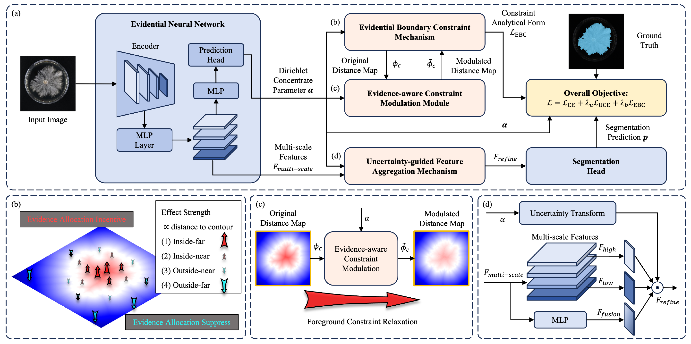
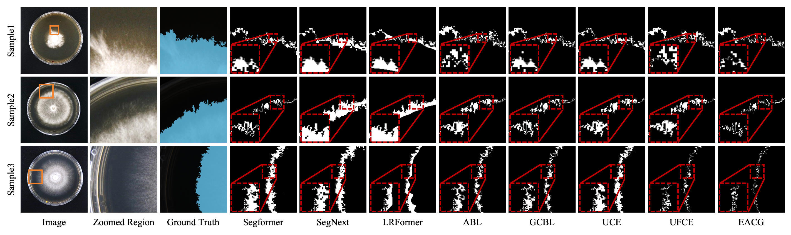

<h3 align="center">
Evidence Matters: Mycelium Boundary-Aware Segmentation<br>
via Evidential Adaptive Constraint and Guidance
</h3>

---

This repository contains the code for the paper "[Evidence Matters: Mycelium Boundary-Aware Segmentation via Evidential Adaptive Constraint and Guidance](https://doi.org/10.1145/3767308.3835395)," accepted at **ACM Multimedia 2026**.

<p align="center">
Qianguang Yuan<sup>1,2</sup>, Yunfei Liu<sup>2,3</sup>, Chang Chi<sup>2</sup>, Xiaohui Yuan<sup>4,3</sup>,<br>
Bolong Zheng<sup>1,2</sup>, Weizhen Liu<sup>1,2,*</sup>, Nanqing Dong<sup>5,6,*</sup>
</p>

<p align="center">
<sup>1</sup> Sanya Science and Education Innovation Park, Wuhan University of Technology<br>
<sup>2</sup> School of Artificial Intelligence, Wuhan University of Technology<br>
<sup>3</sup> Yazhouwan National Laboratory<br>
<sup>4</sup> Jilin Provincial Key Laboratory of MycoPhenomics<br>
<sup>5</sup> Shanghai Innovation Institute<br>
<sup>6</sup> Shanghai Artificial Intelligence Laboratory
</p>

<p align="center">
<sup>*</sup> Corresponding authors:<br>
Weizhen Liu: <a href="mailto:liuweizhen@whut.edu.cn">liuweizhen@whut.edu.cn</a><br>
Nanqing Dong: <a href="mailto:nanqing.dong@sii.edu.cn">nanqing.dong@sii.edu.cn</a>
</p>

## Overview

- [Motivation and Design](#motivation-and-design)
- [Results](#results)
- [Usage](#usage)
- [Citation](#citation)

## Motivation and Design

Mycelium images contain low-contrast, irregular boundaries that make accurate segmentation difficult. **Evidential Adaptive Constraint and Guidance (EACG)** uses pixel-to-boundary distance to constrain the evidence distribution and adaptively relaxes this constraint to reduce overconfident predictions. The calibrated uncertainty then guides multi-scale feature aggregation, combining fine details near uncertain boundaries with semantic context in confident regions.

<p align="center">

</p>

<p align="center"><sub><strong>Framework.</strong> EBC constrains evidence, ECM relaxes the constraint adaptively, and UFA guides multi-scale feature aggregation.</sub></p>

## Results

<p align="center">

</p>

<p align="center"><sub><strong>MyceliumSeg comparisons.</strong> Input images, zoomed regions, ground truth, and segmentation results. EACG is shown in the rightmost column.</sub></p>

EACG results reported in the paper (mean ± standard deviation over five runs):

| Dataset | mS2FBIoU (%) ↑ | mBIoU (%) ↑ |
| :--- | ---: | ---: |
| **MyceliumSeg** | **69.88 ± 0.38** | **70.19 ± 0.55** |
| GWFSS | 23.16 ± 0.14 | 37.33 ± 0.19 |
| PhenoBench | 51.81 ± 0.20 | 67.94 ± 0.18 |
| PMD2023 | 47.51 ± 0.50 | 67.44 ± 0.43 |

## Dataset

The provided configuration targets **MyceliumSeg**[[Paper]](https://doi.org/10.1038/s41597-025-06265-1)|[[Dataset]](https://doi.org/10.5281/zenodo.15224240)|[[Github]](https://github.com/WeizhenLiuBioinform/MyceliumSeg), which contains 507 images from four fungal species at a resolution of 4608 × 3456. The paper uses 412 images for training, 45 for validation, and 50 for testing. It also evaluates EACG on GWFSS, PhenoBench, and PMD2023.

Prepare the dataset separately and set `EACG_DATA_ROOT` (default: `data/MyceliumSeg`). Each split (`train`, `val`, `test`) contains `image/` and `mask/` directories with matching `.jpg` images and `.png` masks. Mask labels are `0` for background, `1` for mycelium, and `255` for ignored pixels. Dataset settings are in [configs/_base_/mycelium.py](configs/_base_/mycelium.py).

## Environment Setup

- Python 3.9 or later and a complete MMSegmentation 1.2.2 checkout.
- Compatible PyTorch, CUDA, and MMCV with compiled operators (`>=2.0.0,<2.2.0`).
- Install the dependencies in [requirements.txt](requirements.txt); boundary evaluation additionally requires [requirements-eval.txt](requirements-eval.txt).

## Usage

Copy the complete `EACG` directory into `mmsegmentation/project/` or `mmsegmentation/projects/`. Run the entry scripts from the MMSegmentation root directory.

- **Configuration:** [configs/eacg_mit-b1_mycelium-512x512-160k.py](configs/eacg_mit-b1_mycelium-512x512-160k.py), using a MiT-B1 backbone. The `_boundary.py` variant enables boundary evaluation.
- **Training:** Total batch size is 8 (8 on one GPU, or `8 / WORLD_SIZE` per GPU with `torchrun` and `--launcher pytorch`; supported GPU counts: 1, 2, 4, 8).
- **Boundary loss:** Weight is 0.25; signed distances are scaled by 0.1 (`full_map_modify`), retaining an effective coefficient of 0.025 on unscaled distances in the provided configuration.
- **Entry scripts:** [tools/train.py](tools/train.py) for training, [tools/test.py](tools/test.py) for evaluation, and [tools/infer.py](tools/infer.py) for single-image inference. Use `--help` to view their arguments.
- **Implementation:** `eacg/models/` contains the decoder and losses, `eacg/datasets/` handles data processing, and `eacg/evaluation/` implements boundary metrics.

Prepare datasets separately; evaluation and inference also require a trained checkpoint.

## Citation

If you use EACG in your research, please cite:

```bibtex
@inproceedings{yuan2026eacg,
  title     = {Evidence Matters: Mycelium Boundary-Aware Segmentation via Evidential Adaptive Constraint and Guidance},
  author    = {Yuan, Qianguang and Liu, Yunfei and Chi, Chang and Yuan, Xiaohui and Zheng, Bolong and Liu, Weizhen and Dong, Nanqing},
  booktitle = {Proceedings of the 34th ACM International Conference on Multimedia},
  series    = {MM '26},
  year      = {2026},
  publisher = {Association for Computing Machinery},
  doi       = {10.1145/3767308.3835395},
  url       = {https://doi.org/10.1145/3767308.3835395}
}
```

This project builds on MMSegmentation. Third-party attribution and license information are provided in [NOTICE.md](NOTICE.md) and [LICENSES/](LICENSES/).
